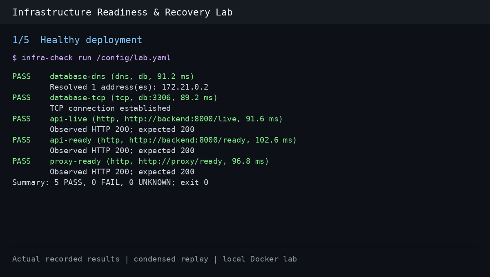

# Infrastructure Readiness & Recovery Lab

[](https://github.com/oussema-code/infra-readiness/actions/workflows/ci.yml)

A Python CLI that checks DNS, TCP connectivity, and HTTP readiness, reports the
observed evidence, and runs against a reproducible API/database/proxy failure lab.

## Demo



A 26-second replay of [recorded CLI results](docs/demo/README.md), with shortened
pauses. Raw JSON evidence and reproduction instructions are included.

## Quick start

Requires Python 3.11+. Clone the repository first:

```bash
git clone https://github.com/oussema-code/infra-readiness.git
cd infra-readiness
python3 -m venv .venv
.venv/bin/python -m pip install -e '.[dev]'
.venv/bin/infra-check validate examples/lab.yaml
.venv/bin/python -m pytest -q
```

Write a configuration using targets reachable from your environment:

```yaml
concurrency: 4
checks:
  - name: local-dns
    type: dns
    host: localhost
  - name: application
    type: http
    url: http://127.0.0.1:18080/ready
    timeout: 4
    expected_status: 200
```

Execute checks, optionally saving a JSON report to an existing directory:

```bash
.venv/bin/infra-check run checks.yaml --json report.json
# JSON only on stdout, suitable for another program:
.venv/bin/infra-check run checks.yaml --json -
```

Validation makes no network requests. Execution validates the entire file before
starting workers. Results remain in configuration order.

## Run the Compose lab

Requires Docker Engine and Compose:

```bash
docker compose -p pfe-readiness-dev -f lab/compose.yaml up --build --wait --wait-timeout 180
docker compose -p pfe-readiness-dev -f lab/compose.yaml build checker
docker compose -p pfe-readiness-dev -f lab/compose.yaml run --rm -T checker
curl --fail http://127.0.0.1:18080/ready
```

```text
Host 127.0.0.1:18080 -> NGINX -> Flask API -> MariaDB
                                  /live: process responds
                                  /ready: query returns expected seeded records

Checker container -> DNS / TCP / HTTP checks across both Compose networks
```

The checker uses `examples/lab.yaml`, with service names that resolve inside the
Compose networks. It has no Docker socket or database credentials. Set `LAB_PORT`
to change the loopback port; the API and database publish no host ports.

Stop the lab, retaining its synthetic data:

```bash
docker compose -p pfe-readiness-dev -f lab/compose.yaml down
```

Append `--volumes` for a fresh database. That deletes this project's disposable
lab data; initialization SQL only runs against an empty database volume.

## Automated failure and recovery exercise

```bash
.venv/bin/python scripts/lab_smoke.py
```

The script creates a randomly named Compose project and uses an ephemeral loopback
port. After the healthy baseline, it runs these cases:

| Failure exercise | Required evidence | Recovery verification |
| --- | --- | --- |
| Database stopped | Liveness passes; direct and proxied readiness return HTTP 503 | Restart database; all five baseline checks pass |
| Invalid hostname | DNS reports FAIL/not-found or UNKNOWN/incomplete evidence; liveness passes | Restore original checker targets; all five baseline checks pass |
| Delayed API | A 1-second check of `/slow-ready` times out as UNKNOWN; liveness passes | Restore the normal `/ready` target; all five baseline checks pass |
| Wrong proxy upstream | Proxy returns HTTP 502; direct API and database checks pass | Restore NGINX configuration and reload; all five baseline checks pass |

The lab-only `/slow-ready` fixture waits three seconds before executing the normal
readiness query; it does not slow `/live` or `/ready`. The hostname and delay cases
change checker targets, not the underlying services. The proxy exercise copies a
deliberately broken upstream configuration into its own proxy container, validates
it, reloads NGINX, and polls for the new status before checking. The original
configuration is restored in a `finally` block.

Expected check failures are assertions in the harness; an arbitrary nonzero exit
does not count as success. DNS is intentionally allowed to return incomplete
evidence when the host's resolver cannot establish a definitive negative result.

JSON reports and service logs are retained under `reports/<project>/`, including
on failure. The script removes its own containers, networks, and disposable volume
in a `finally` block. It does not modify an existing development lab.

For API unit tests with mocked database calls:

```bash
.venv/bin/python -m pip install -r lab/backend/requirements.txt
.venv/bin/python -m unittest discover -s lab/tests -v
```

## Evidence and execution model

- **PASS:** the configured expectation was observed.
- **FAIL:** a negative result was observed, such as a refused connection or an
  unexpected HTTP status.
- **UNKNOWN:** insufficient evidence, such as a timeout or temporary resolver
  failure. It does not establish that the service is down.

Each active check runs in a separate Python process. A semaphore limits the
number of active workers. The parent enforces an end-to-end deadline, including
DNS, connection setup, TLS, and HTTP headers, then kills and reaps a timed-out
worker. Queue time is excluded; process startup and cleanup appear in the reported
duration. Cleanup and OS scheduling may add small overhead beyond the deadline.

HTTP uses GET, verifies HTTPS certificates, does not follow redirects, and does not
consume response bodies. A status result therefore proves nothing about body
completeness. HTTP environment proxies are not used. There are no automatic retries.

Results contain `name`, `type`, `target`, `status`, `duration_ms`, `evidence`, and
nullable `error_category`. JSON includes a schema version, UTC timestamp, summary,
and exit code. Worker execution failures retain an UNKNOWN result with
`error_category: tool_error` and make the command return 3.

| Execution exit | Meaning, in precedence order |
| --- | --- |
| 3 | Configuration, worker, or report-writing error |
| 1 | At least one FAIL |
| 2 | UNKNOWN results without FAIL |
| 0 | All checks PASS |

Ctrl+C returns 130 and cleans up active workers. CLI argument errors use argparse's
exit 2. `validate` returns 0 for valid configuration and 3 for invalid configuration.

## Configuration

Each check needs a unique printable `name`, `type`, and optional `timeout` (default
2 seconds, range 0.1–60). DNS requires `host`; TCP requires `host` and `port`; HTTP
requires `url` and accepts `expected_status` (default 200). Concurrency defaults
to 4 and must be 1–32. Configurations contain 1–100 checks and are at most 64 KiB.
Unknown fields, duplicate YAML keys, and duplicate check names are rejected.

YAML uses a [safe loader](https://pyyaml.org/wiki/PyYAMLDocumentation).
HTTP URLs cannot contain credentials, queries, or fragments in version 1. Do not
put secret values in names or targets: those fields appear in reports.

## Verified locally

- Configuration, result aggregation, actual local DNS/TCP/HTTP traffic, malformed
  responses, redirects, slow headers, process cancellation, and concurrency limits.
- JSON/terminal consistency, file-write errors, and input-file overwrite protection.
- Live Compose baseline: **5 PASS**; database outage: **1 PASS, 2 FAIL, 2 UNKNOWN**;
  recovery: **5 PASS**. See [the incident note](docs/database-outage.md).
- Invalid-hostname, delayed-response, and wrong-upstream Compose scenarios, each
  followed by a passing baseline. See [the scenario notes](docs/diagnostic-scenarios.md).
- [Verified GitHub Actions run](https://github.com/oussema-code/infra-readiness/actions/runs/41499281433):
  78 tests passed on Python 3.11 and 3.13, plus all four Compose failure/recovery
  exercises. JSON reports and service logs are uploaded as artifacts. The badge
  above shows the latest run status.

## Source and limits

The lab is adapted from Docker's [Awesome Compose sample](https://github.com/docker/awesome-compose/tree/30f4b7f6a6c3b0c0ecf4d4efb0de203c48d11562/nginx-flask-mysql).
See [lab/UPSTREAM.md](lab/UPSTREAM.md) for the exact source, modifications, and CC0
license. The diagnostic tool and failure/recovery harness are project additions.

This is a local learning lab using public test passwords and Flask's development
server with debugging disabled. It demonstrates no production-scale reliability.
Per-check processes trade startup overhead for enforceable DNS and HTTP deadlines;
very short deadlines can expire during process startup on a busy machine.
Database socket timeouts bound individual operations, not total API request time.
Image tags are not digest-pinned. Windows and macOS have not been tested.

The new project code is available under the [MIT license](LICENSE); the upstream
lab dedication is retained separately. See [the implementation plan](docs/BUILD_PLAN.md)
and [the interview walkthrough](docs/WALKTHROUGH.md).
