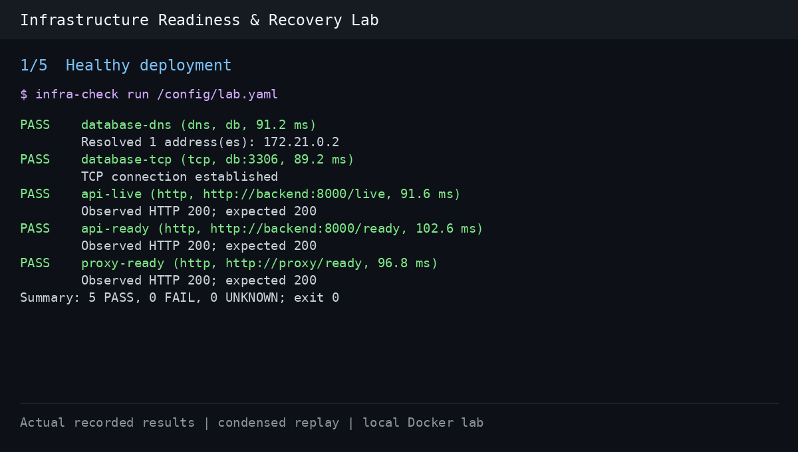

# Recorded lab demo



This is a condensed terminal-style replay of actual JSON results captured by
`scripts/lab_smoke.py` on 2026-11-02, local run `readiness-smoke-a3045315`.
It is not a real-time screen recording: each frame uses the CLI's own report
formatter, with time between stages shortened for readability. The underlying
reports, timestamps, and observed durations are in `evidence/`.

The sequence shows the healthy baseline, an invalid hostname, a delayed API,
a broken proxy upstream, and recovery. The full harness also tests a database
outage; its investigation is in `../database-outage.md`.

Reproduce the live exercise from the repository root:

```bash
python scripts/lab_smoke.py
```

To rebuild the GIF from the checked-in reports (optional authoring dependency):

```bash
python -m pip install -e . Pillow
python scripts/render_demo.py
```

Pillow is only required to render the GIF, not to run the checker or the lab.
The renderer uses DejaVu Sans Mono; set `DEMO_FONT` to another installed monospace
font file if it is unavailable on your system.
